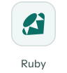
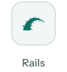
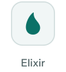
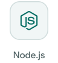
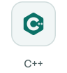
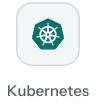
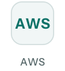
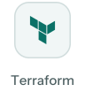
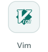

<a href="https://sergiohilgert.com">
  <picture>
    <source media="(prefers-color-scheme: dark)" srcset="assets/banner-dark.svg">
    <source media="(prefers-color-scheme: light)" srcset="assets/banner-light.svg">
    
  </picture>
</a>

  I build and scale backend systems, mostly in Ruby on Rails. 
  Software Engineer at <a href="https://github.com/tech-lia">@tech-lia</a>.

  <a href="https://www.ruby-lang.org/en/"><picture><source media="(prefers-color-scheme: dark)" srcset="assets/ruby-dark.svg"><source media="(prefers-color-scheme: light)" srcset="assets/ruby-light.svg"></picture></a>
  <a href="https://rubyonrails.org/"><picture><source media="(prefers-color-scheme: dark)" srcset="assets/rubyonrails-dark.svg"><source media="(prefers-color-scheme: light)" srcset="assets/rubyonrails-light.svg"></picture></a>
  <a href="https://elixir-lang.org/"><picture><source media="(prefers-color-scheme: dark)" srcset="assets/elixir-dark.svg"><source media="(prefers-color-scheme: light)" srcset="assets/elixir-light.svg"></picture></a>
  <a href="https://nodejs.org/en/"><picture><source media="(prefers-color-scheme: dark)" srcset="assets/nodejs-dark.svg"><source media="(prefers-color-scheme: light)" srcset="assets/nodejs-light.svg"></picture></a>
  <a href="https://isocpp.org/"><picture><source media="(prefers-color-scheme: dark)" srcset="assets/cpp-dark.svg"><source media="(prefers-color-scheme: light)" srcset="assets/cpp-light.svg"></picture></a>
  <a href="https://www.postgresql.org/"><picture><source media="(prefers-color-scheme: dark)" srcset="assets/postgresql-dark.svg"><source media="(prefers-color-scheme: light)" srcset="assets/postgresql-light.svg"></picture></a>
  <a href="https://kubernetes.io/"><picture><source media="(prefers-color-scheme: dark)" srcset="assets/kubernetes-dark.svg"><source media="(prefers-color-scheme: light)" srcset="assets/kubernetes-light.svg"></picture></a>
  <a href="https://aws.amazon.com/"><picture><source media="(prefers-color-scheme: dark)" srcset="assets/aws-dark.svg"><source media="(prefers-color-scheme: light)" srcset="assets/aws-light.svg"></picture></a>
  <a href="https://www.terraform.io/"><picture><source media="(prefers-color-scheme: dark)" srcset="assets/terraform-dark.svg"><source media="(prefers-color-scheme: light)" srcset="assets/terraform-light.svg"></picture></a>
  <a href="https://www.vim.org/"><picture><source media="(prefers-color-scheme: dark)" srcset="assets/vim-dark.svg"><source media="(prefers-color-scheme: light)" srcset="assets/vim-light.svg"></picture></a>

<h3 align="center">Projects</h3>

  <a href="https://squad.reviews"><b>Squad Reviews</b></a>
  &nbsp;·&nbsp;
  <a href="https://squad.reviews"><code>squad.reviews</code></a> 
  Tools for developers and managers: live retrospectives, team health checks and a whiteboard, in one place.

  <a href="https://sergiohilgert.com"><b>sergiohilgert.com</b></a>
  &nbsp;·&nbsp;
  <a href="https://www.linkedin.com/in/sergio-hilgert"><b>LinkedIn</b></a>
  &nbsp;·&nbsp;
  <a href="mailto:contato@sergiohilgert.com"><b>E-mail</b></a>

